# Mama Mboga

**Daily-price ordering for neighbourhood greengrocers, built in framework-free PHP 8.**

**Live demo: <https://victor-wambua.github.io/mama-mboga/>** (static, runs the real PHP code in your browser on invented data).

The owner sets the day's prices, customers order from their phones, WhatsApp orders are read into drafts, and the credit book ("deni") never loses a shilling.

[](https://github.com/Victor-Wambua/mama-mboga/actions/workflows/ci.yml)
[](LICENSE)


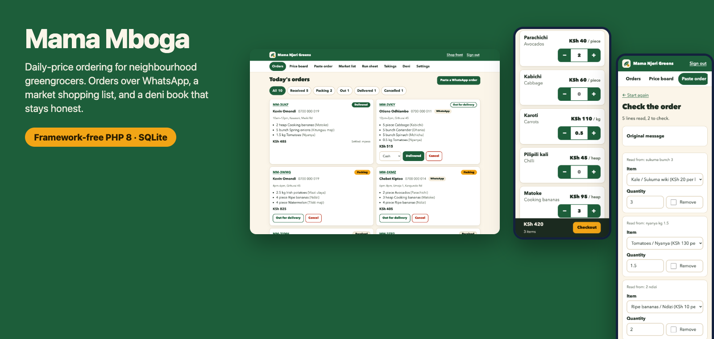

> **Status: portfolio build, runs locally with sample data.** "Mama Njeri Greens" is a made-up shop; every customer, phone number and order is synthetic. The owner can optionally collect deni with an M-Pesa prompt through a [payments gateway](#live-gateway), which this repository has only exercised against the gateway's mock and its tests; no WhatsApp API is connected (see [limits](#status-and-roadmap)). The full app needs PHP, so the hosted page is a [browser demo](#live-demo) of the owner console that runs the real code under WebAssembly.

## The problem

A neighbourhood greengrocer's trade runs on three things: WhatsApp messages ("sukuma 2 bunch, tomato 1kg, deliver 6pm"), a notebook of who owes what (*deni*), and prices that change every morning with the market. Orders get misread. The owner re-types everyone's order into one shopping list before dawn. Credit balances get lost, argued about, or quietly written off.

## What it does

- **Daily price board.** Each morning the owner sets today's items: English and Swahili names, unit (kg, bunch, piece, heap/*rundo*), price in KES, stock, and an optional "special". One tap copies yesterday's list.
- **Mobile-first menu, no login.** Customers see today's prices, build a basket with unit-aware steppers (kg in half-kilo steps, bunches whole), pick a capacity-limited delivery slot or pickup, and order.
- **WhatsApp bridge.** After ordering, the customer gets a pre-filled `wa.me` link with their order and reference, URL-encoded correctly (Swahili text, bullets, line breaks). The order is saved either way.
- **Paste-a-message parser.** The owner pastes a customer's WhatsApp message; it is matched against today's board (English and Swahili names, aliases, typos, "kilo moja na nusu", "kumi na mbili ndizi", grams, fractions) into a draft. Anything uncertain is flagged for a human, never guessed silently.
- **Owner console** (PIN or password, sessions, CSRF): orders board with a status flow (received, packing, out, delivered, cancelled), **market shopping list** with "bought" check-offs and a print view, **delivery run sheet** by slot, **daily takings**.
- **Deni ledger.** Credit limits per customer, an append-only ledger of charges, payments and credit notes in integer KES, M-Pesa codes or numbered cash receipts, aging buckets, a statement the customer opens through a signed link, and polite reminder messages (Swahili or English) as pre-filled WhatsApp links, and an optional **M-Pesa prompt** to collect a customer's deni (see [Live gateway](#live-gateway)).
- **Built for cheap phones.** The menu page is 16.8 KB of HTML plus 14.1 KB CSS and about 3 KB of vanilla JS (3.0 + 3.7 KB gzipped). Installable PWA, offline menu, dark mode, 48 px touch targets, works at 360 px.

| Customer menu (360 px) | Checkout | Paste a WhatsApp order |
| --- | --- | --- |
| 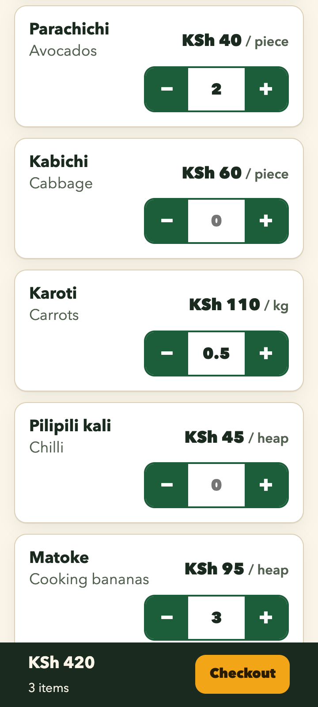 | 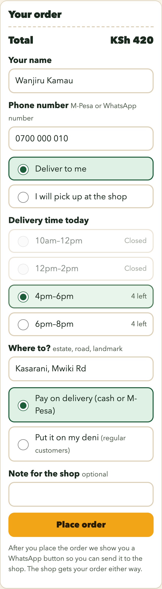 | 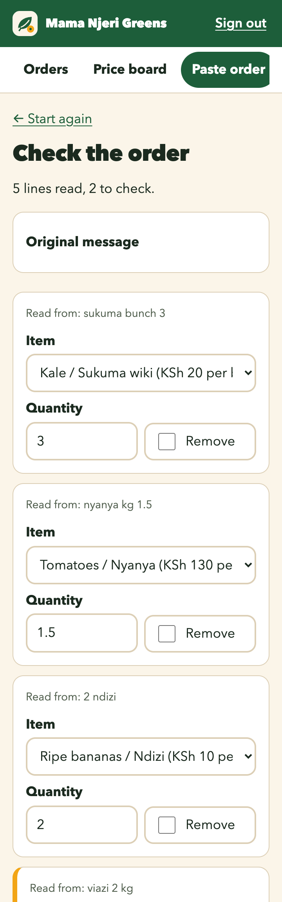 |

| Market shopping list | Dark mode | Deni ledger |
| --- | --- | --- |
| 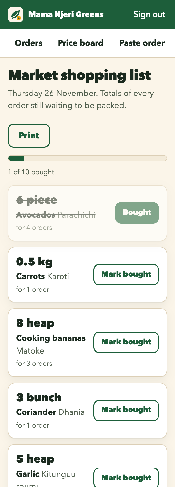 | 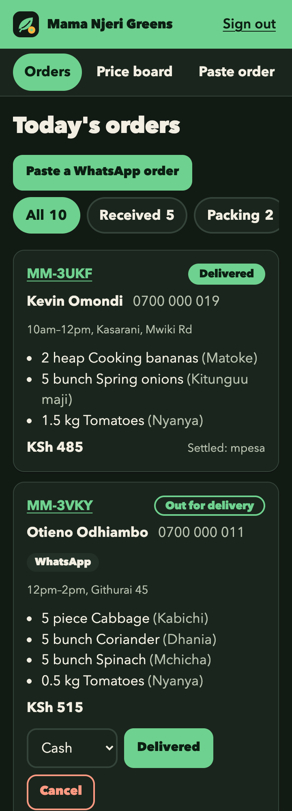 | 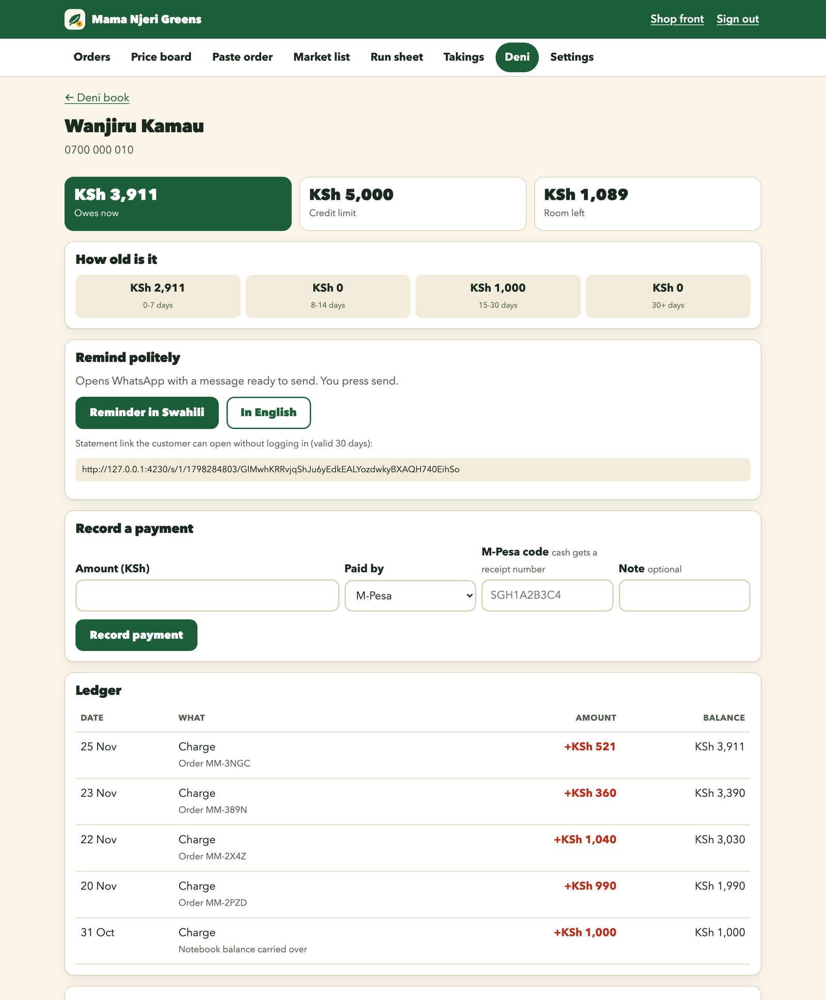 |

## Live demo

<https://victor-wambua.github.io/mama-mboga/> is a static page on GitHub Pages. It runs this repository's own PHP (services, WhatsApp parser, ledger, SQLite repositories, migrations, demo seeder) unchanged under PHP 8.3 compiled to WebAssembly, in a web worker. Nothing is a port or a recording.

- **Real:** price board, order placing with stock and credit checks, the WhatsApp message reader and its flags, the market list, the deni ledger and its rules, the reminder messages, the collect-by-prompt rules (amount check, request id, reconcile step), and the SQLite database with its append-only triggers.
- **Replaced:** the HTTP layer, sessions, PIN login, CSRF and page templates. The page is a separate front end in `demo/web/` that calls the services through `demo/php/Bridge.php`. The shop clock is fixed at 06:30 on today's date so delivery slots stay open.
- **Collect by prompt:** PHP running in the browser has no network, so in the demo the browser, not PHP, talks to the gateway (`demo/web/gateway.js`). It calls the gateway's mock with a public demo key, polls it, and hands PHP the payment it read; PHP then runs the app's real reconcile step. An opt-in Safaricom sandbox choice sends a real prompt to a number you type, as a flat KES 1 test charge that stands in for the amount, behind a tick-box that is never remembered. See [Live gateway](#live-gateway).
- **Not shown:** the customer menu and checkout, run sheet, takings, settings, signed statement links and the installable app.
- **State:** the database lives in browser memory, a copy is kept in IndexedDB, and Reset restores the sample shop. The only thing that leaves the browser is a prompt you choose to send to the gateway. The PHP runtime is about 18 MB unpacked, about 7 MB over the network, and is cached for offline use after the first visit.
- **Checks:** `tests/Demo/BridgeTest.php` runs the bridge on native PHP in PHPUnit, and `cd demo && npm ci && npm run build && npm test` runs 14 unit tests of the gateway client and poller, then a Playwright smoke test that drives the built page in Chromium in CI. Both gateways are stubbed in those tests; CI never reaches a real one.

| Read a WhatsApp order | Deni book, with a payment held for review | Market list (phone, dark) |
| --- | --- | --- |
| 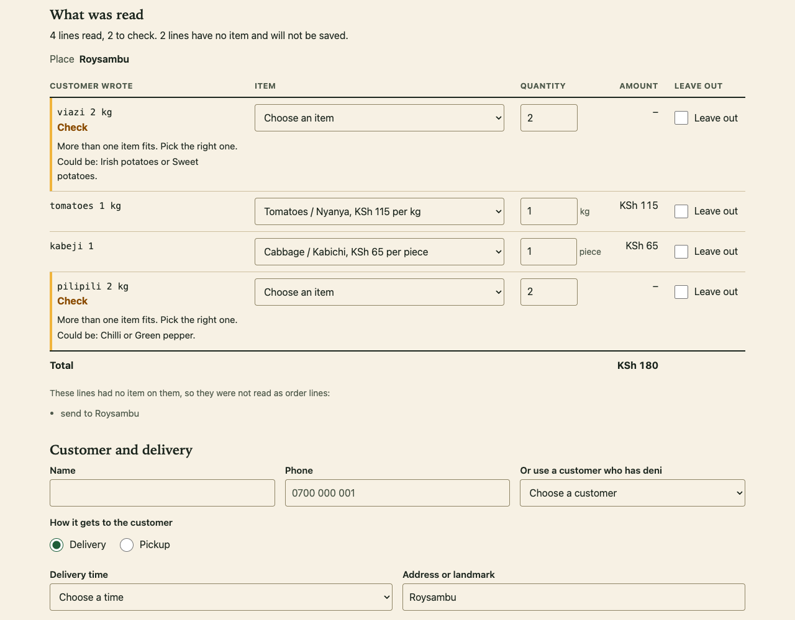 | 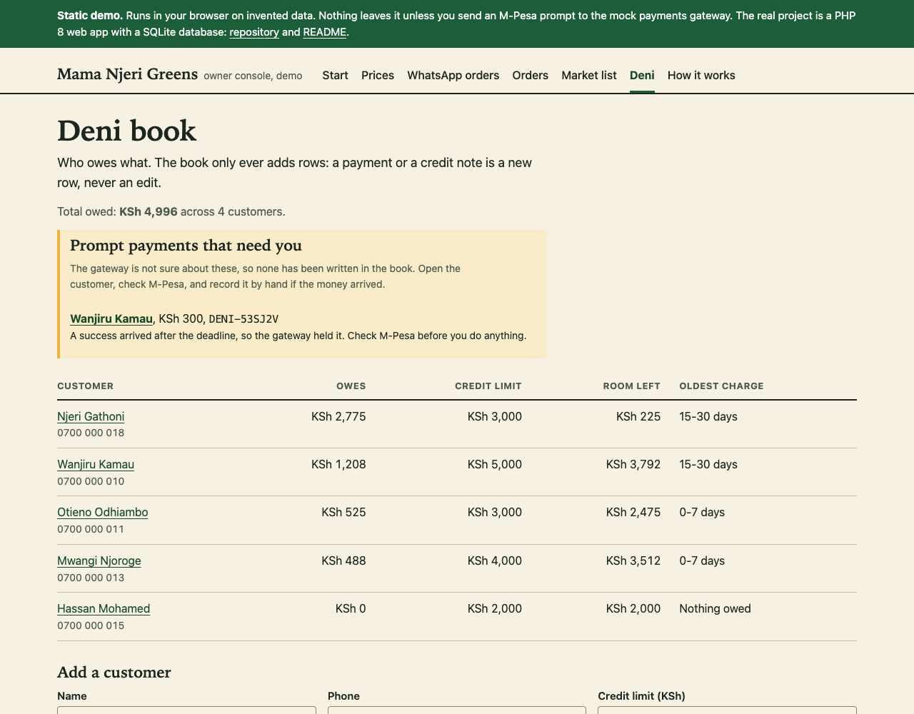 | 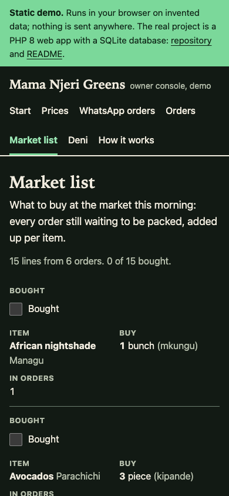 |

| Collect by prompt, confirming | A late success held for the owner | Sandbox choice (phone) |
| --- | --- | --- |
| 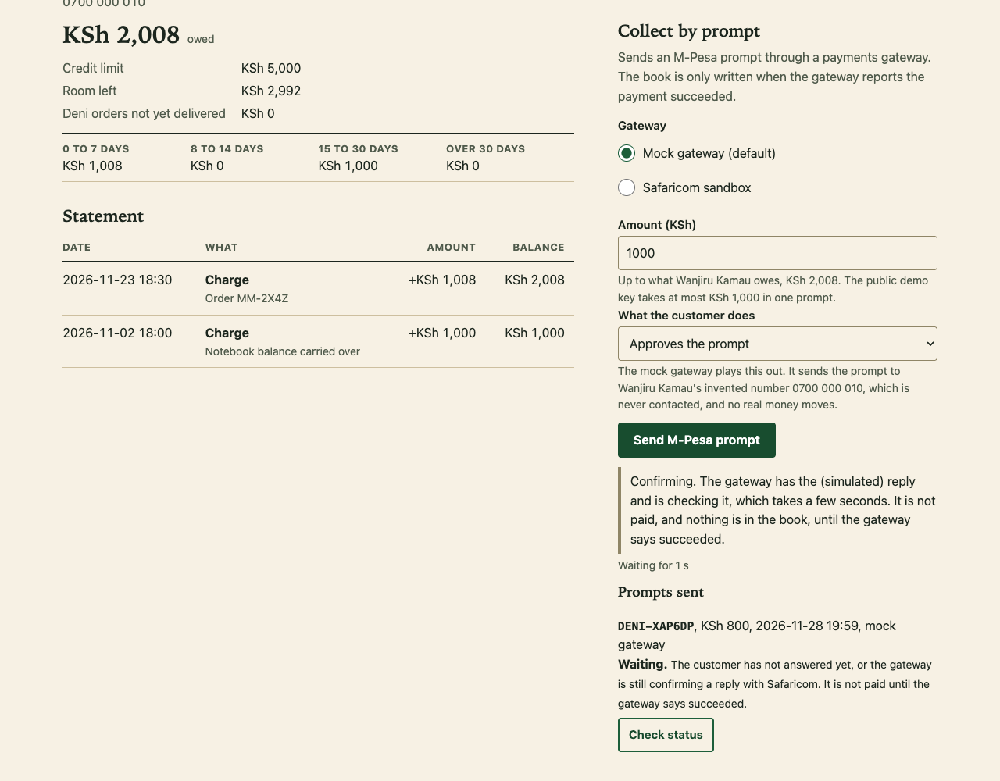 | 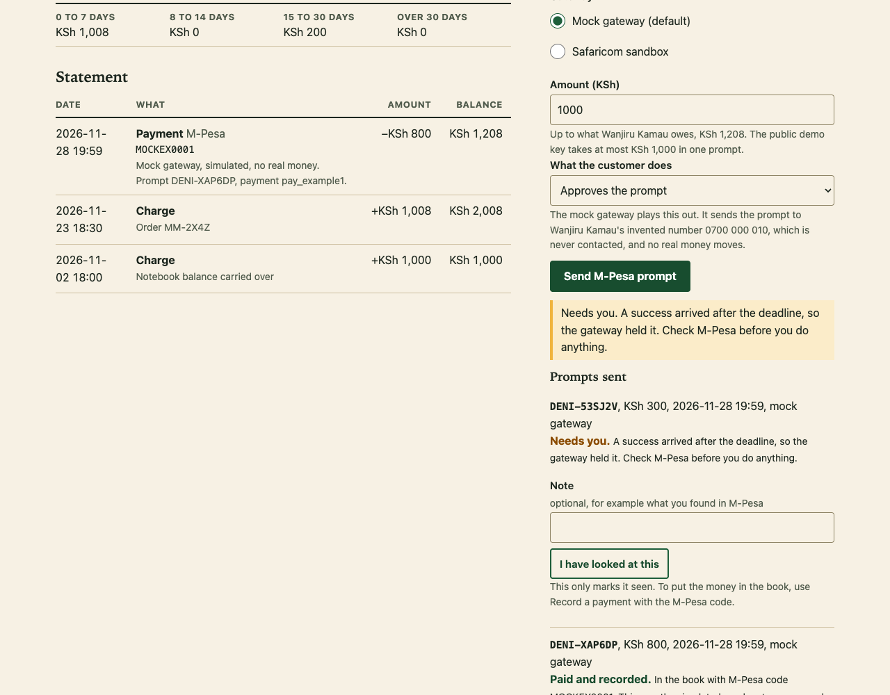 | 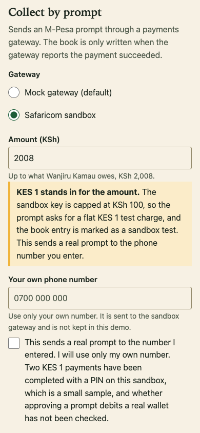 |

The collect-by-prompt screenshots were taken with the gateway's responses stubbed so the states are repeatable. The sandbox picture shows the acknowledgement before anything is sent.

## Live gateway

The owner console can collect a customer's deni with an M-Pesa prompt, through the payments gateway at [Victor-Wambua/mpesa-gateway](https://github.com/Victor-Wambua/mpesa-gateway). On a customer's page, **Collect deni by prompt** takes an amount (blank means the whole balance, never more than is owed), saves a request with a short id such as `DENI-7K3Q2X`, and asks the gateway to send the prompt to the customer's own number.

**What is real, and what the app guarantees**

- The book is written only when the gateway reports `succeeded`, and only through the existing ledger rules. A receipt code is used once and a payment can never exceed what is owed, so a reused receipt or an overpayment is refused and shown to the owner, not forced in.
- It is idempotent: the request has a stable idempotency key, so a resend cannot send a second prompt, and a gateway payment id is attached to one request and recorded once, however often it is checked.
- `needs_review`, a late success (a success after the deadline), and a success whose callback and status check disagree are shown to the owner as items that need them. They are never recorded automatically; marking one as seen does not touch the book.
- The ledger and its append-only triggers are untouched. The `payment_requests` table only points at the ledger row that recorded it.
- `gateway:reconcile` (`php bin/console gateway:reconcile`, safe for cron) and the **Check status** button ask the gateway where waiting prompts stand. The app polls; it does not receive the gateway's webhooks yet.

**What is simulated or unverified**

- The tests and the demo use a fake and a stub gateway. The demo's default is the gateway's mock, which plays out the outcome you pick and contacts no phone. Its entries are labelled as simulated.
- The gateway has been observed against Safaricom's sandbox: a real prompt reached a real phone, and two KES 1 payments were completed with a PIN by the owner on their own numbers. That is a small sample, and whether a sandbox success debits a real wallet has not been checked. This repository has not been run against a live Safaricom account.
- In the demo's sandbox option the entry is marked as a sandbox test: KES 1 was charged and it stands in for the amount.

Set it up in `.env`: `GATEWAY_URL` and `GATEWAY_SECRET_KEY` (a server-side secret; it is never sent to a browser). Leave them blank and the feature shows how to set it up instead of failing. The curl client needs PHP's `curl` extension.

The PHP-WASM runtime comes from the WordPress Playground project under its own licences, see `demo/THIRD-PARTY-NOTICES.txt`.

## Quick start

Needs PHP 8.3+ with `pdo_sqlite` and `mbstring`, and Composer.

```bash
git clone https://github.com/Victor-Wambua/mama-mboga.git
cd mama-mboga
composer install
composer seed     # creates .env and an APP_KEY, migrates, loads the demo shop
composer serve    # http://127.0.0.1:8080
```

- Shop front: <http://127.0.0.1:8080>
- Owner console: <http://127.0.0.1:8080/owner>, demo PIN `246810` (sample data only; set your own with `php bin/console owner:pin <6+ characters>`).

`composer seed` resets the database. To start empty instead, run `composer setup` and then `php bin/console owner:pin ...`.

## How it works

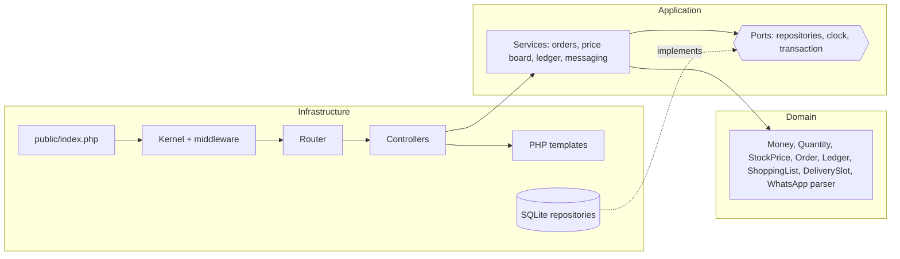

The **domain** layer is plain PHP with no I/O: money, orders, the ledger and the message parser can be tested with no database. The **application** layer coordinates them through small ports (repository interfaces, a clock, a transaction). **Infrastructure** holds everything with a side effect: the hand-written HTTP core (request/response, router with `{id:\d+}` parameters, middleware pipeline, an autowiring container, sessions in SQLite), PDO repositories, migrations and the template engine.

Decisions worth knowing (details in [docs/CASE-STUDY.md](docs/CASE-STUDY.md)):

- **Money is an integer number of shillings.** Quantities are integer thousandths, so 1.5 kg x KSh 85 is `1500 * 85 / 1000` rounded half-up. No float touches money.
- **The ledger is append-only in two places.** The domain `Ledger` returns a new ledger on every append and enforces its invariants; SQLite triggers also refuse `UPDATE` and `DELETE` on the table.
- **Stock and slot capacity are checked inside one `BEGIN IMMEDIATE` transaction**, so two customers cannot take the last bunch or the last delivery place.
- **Output is escaped by convention and checked by a test.** Templates echo only through `$e()` and friends; a test scans every template. The CSP forbids inline script and style, so there are none.
- **The parser flags instead of guessing.** Partial matches, ambiguity (`viazi` is Irish or sweet), unit mismatches (`sukuma 2 kg` when it is sold by the bunch) and odd amounts all go to the owner for confirmation.

## Testing

```bash
composer test       # PHPUnit
composer stan       # PHPStan level 8
composer cs         # PHP-CS-Fixer, PSR-12 (composer cs:fix to apply)
composer accuracy   # score the WhatsApp parser on its case tables
composer check      # all of the above except accuracy
```

Real numbers from the last run: **530 tests, 1,504 assertions, all passing** on PHP 8.4 and PHP 8.3; PHPStan level 8 reports no errors; the code style check is clean. CI runs the same on 8.3 and 8.4, then seeds the demo and requests the home page. Tests run offline against in-memory SQLite and a frozen clock. Coverage is not measured.

| Area | Tests | What is covered |
| --- | ---: | --- |
| WhatsApp parser | 197 | 178 table-driven cases plus matcher, edit distance, normaliser, address/phone/time extraction |
| Money, quantities, phones | 42 | half-up rounding table, decimal parsing, Kenyan number formats |
| Ledger, slots, takings, shopping list, orders | 52 | overpay, credit limit, duplicate receipts, one charge per order, FIFO aging, capacity, cut-off |
| Application services | 51 | stock reservation, last-item race, slot capacity, deni limit, cancel restores stock, WhatsApp links |
| Router, container, middleware, sessions, DB | 51 | route params, 404/405, circular DI, CSRF, rate limit, session fixation, migration rollback, append-only triggers |
| Browser demo bridge (native PHP) | 24 | seeded shop, price edits, parser flags, quotes, order to market list, deni rules, reminders, collect-by-prompt on a payment the page supplies |
| Collect by prompt (service, fake gateway) | 39 | amount never above the balance, record only on `succeeded`, idempotent by payment id and receipt, duplicate receipt and overpayment refused, held and disagreeing payments never recorded, retries |
| Gateway client (stub transport and a localhost stub over real curl) | 17 | request shape, idempotency key, error mapping, `Retry-After`, unreachable, unconfigured |
| Collect by prompt over HTTP | 9 | auth on the new routes, default amount, refusals, check status, held items on the deni book |
| HTTP feature tests (in-process) | 48 | order flow, auth on every owner route, XSS, signed links, expiry, 100 KB budget |

### Parser accuracy (read this before trusting the number)

`composer accuracy` scores two hand-written tables of realistic messages:

| Batch | Cases | Exact |
| --- | ---: | ---: |
| A: written while building and tuning | 121 | 121 (100%) |
| B: written afterwards, run once before any fix | 57 | 54 (94.7%) |
| B after fixing its 3 misses | 57 | 57 (100%) |

"Exact" means every line matched the right item, quantity and unit, and every line that should be flagged was flagged. These are my own cases, not messages from real shoppers, so 100% is a regression guarantee, not a forecast. The honest number is batch B's first run: **94.7% on phrasing the parser had not been tuned on.** The 3 misses were an address read as an item, a bare "Ok", and a price ("20 bob").

## Project layout

```
src/
  Domain/          Money, Quantity, Unit, StockPrice, Order, Ledger, ShoppingList, DeliverySlot, Parsing/
  Application/     Services (incl. PaymentCollectionService), ports (interfaces, incl. GatewayClient), Gateway/ and Collection/ value types, WhatsApp/reminder messages, demo seeder
  Infrastructure/  Http (router, kernel, middleware), Container, Persistence (PDO, migrations), Gateway (curl client), View, Security
  Web/             Controllers and signed-link helper
templates/         Plain PHP templates (public/, owner/, partials/, layouts/)
public/            Front controller, CSS, three small JS files, manifest, service worker
migrations/        Numbered .sql files
bin/console        setup, migrate, seed, owner:pin, parser:accuracy, gateway:reconcile
tests/             Domain, Application, Infrastructure, Feature, Support, Fixtures (parser case tables)
docs/              CASE-STUDY.md, screenshots/
```

## Configuration

Set in `.env` (created from `.env.example`) or the environment.

| Variable | Default | Meaning |
| --- | --- | --- |
| `APP_ENV` | `local` | `production` refuses to start with a placeholder `APP_KEY` |
| `APP_KEY` | generated by `composer seed` | HMAC secret for signed statement and order links |
| `APP_URL` | empty | Public base URL used in links sent by WhatsApp; empty uses the request host |
| `APP_TIMEZONE` | `Africa/Nairobi` | Day boundaries and slot cut-offs |
| `DB_PATH` | `var/mama-mboga.sqlite` | SQLite file |
| `APP_DEBUG` | `0` | Show exception class and message on the error page |
| `GATEWAY_URL` | empty | Base URL of the payments gateway; blank switches collect-by-prompt off |
| `GATEWAY_SECRET_KEY` | empty | The gateway's secret key, kept on the server |

Shop name, WhatsApp number, slot size and the owner PIN live in the database and are edited under **Settings**.

## Status and roadmap

Working: everything listed above, on a single shop with sample data. Not done, on purpose:

- **Payments go through a gateway, not Daraja directly.** Collect-by-prompt needs the separate payments gateway, and the app polls it; it does not receive its signed webhooks yet. Cash and any M-Pesa payment outside a prompt are still recorded by hand with their code. See [Live gateway](#live-gateway) for what has and has not been verified.
- **WhatsApp is a link, not an API.** The app never sends anything; the customer or owner presses send. Automatic status messages would need the Business API.
- **One shop, one owner login.** No multi-tenant model, no staff roles.
- **Rate limiting trusts `REMOTE_ADDR`.** Behind a proxy, set it up to pass the real client address.
- **The parser is rule-based and tuned on my own examples.** It has not seen real customers' messages.

Next steps: receive the gateway's signed webhook instead of polling, a customer "reorder last basket" button, stock-in from the market list ("bought" adds to stock), and per-customer price lists.

---

Built by Victor Wambua. [Portfolio](https://victor-wambua.github.io/victor-portfolio/) · [Case studies](https://github.com/Victor-Wambua/case-studies). Licensed under the [MIT License](LICENSE).
