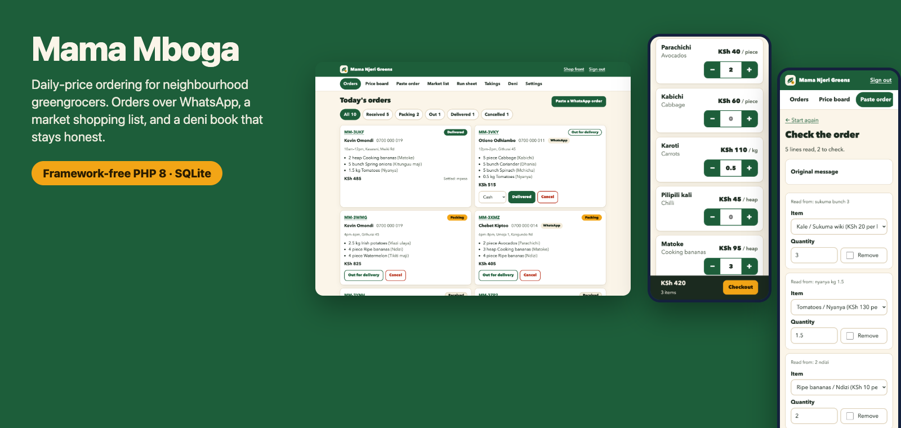

# Mama Mboga: case study

## The problem

A neighbourhood greengrocer in Nairobi runs a surprisingly complicated business out of a phone. Customers send WhatsApp messages in a mix of English and Swahili: "sukuma 2 bunch, nyanya kilo moja na nusu, deliver 6pm". Prices change every morning at the market. Regulars take goods on credit and the balance lives in a notebook. Three things hurt:

- **Orders get misread.** "Viazi 2kg" could be Irish or sweet potatoes. A quantity is missed in a long message.
- **The shopping list is typed by hand.** Before dawn the owner adds up every order into what to buy.
- **Deni goes missing.** A page is torn, a payment forgotten, and the next conversation is an argument.

I wanted to see how much one person could fix with a small, honest system, built the way I would build anything that handles other people's money.

## Goals and non-goals

Goals: a price board set in minutes; ordering that works on a 360 px low-end phone; a bridge to WhatsApp, not a replacement; a market list generated from orders; a credit ledger that cannot be quietly edited; integer shillings everywhere.

Non-goals: payments processing, multi-shop tenancy, a native app, and any claim that this has users. It is a portfolio build with synthetic data.

## What I built

A PHP 8.3+/8.4 app with no framework and no runtime dependencies beyond `pdo_sqlite` and `mbstring`: a customer menu with basket and delivery slots, a WhatsApp link after ordering, a pasted-message parser, an owner console (orders, price board, market list, run sheet, takings), and a deni ledger with signed statement links. Domain code (money, orders, ledger, parser) has no I/O; the application layer talks to it through small ports; SQLite and HTTP sit outside.

## Design decisions and trade-offs

**1. No framework, and what that cost.** The brief was to show I understand what a framework does. So I wrote a router with typed parameters, a middleware pipeline, an autowiring container, SQLite-backed sessions, CSRF, a rate limiter and a migration runner. It came to about 2,000 lines under `src/Infrastructure` (including the PDO repositories) and 51 tests. The honest cost: I now own bugs a framework would have fixed for years. One example surfaced late: `PDO::inTransaction()` does not see a raw `BEGIN IMMEDIATE` on PHP 8.3 the way it does on 8.4, so my rollback silently skipped and the next statement failed with "cannot start a transaction within a transaction". My tests caught it only because I ran the suite on both versions before pushing. For a real shop I would reach for Laravel or Slim and spend the saved time on features. Here the point was the reasoning, so the choice is documented rather than recommended.

**2. Integer money, thousandths for quantities.** Shillings are whole numbers. Quantities are integer thousandths (`1500` is 1.5 kg), so a line total is `price * milli / 1000`, rounded half-up once per line. KSh 110 for a quarter kilo is 27.5, so it is KSh 28, and the customer, the owner's screen, the WhatsApp message and the ledger all agree because they all call the same function. The alternative, floats with rounding at the edges, was rejected because the failure is silent and cumulative.

**3. An append-only ledger enforced twice.** The `Ledger` domain object returns a new ledger on every append and refuses: overpayment (the balance may not go negative), a charge over the credit limit, a reused receipt code, a second charge for the same order, and entries dated before the latest one. Corrections are new entries (a credit note with a reason). Then the same rule is enforced in SQLite with `BEFORE UPDATE` and `BEFORE DELETE` triggers that abort, plus unique indexes on receipt codes and on charge-per-order, so a bug in application code or a hand-typed SQL statement cannot rewrite history either. A test runs raw `UPDATE` and `DELETE` and asserts they fail.  Event sourcing would be more machinery than one shop needs.

**4. Parsing messy text: pipeline, not regex.** The parser is the part I spent longest on. It runs per line: normalise (case, emoji, `½`, list markers, WhatsApp export prefixes), lift out chatter (phone numbers, "6pm", "send to Kasarani"), rewrite number words ("kumi na mbili" becomes 12, "na nusu" adds 0.5, "mikungu mitatu" is 3 with its noun-class agreement), split on commas and "na"/"and", then group tokens into quantity-unit-item clusters in whichever order they were written, so "sukuma 2 nyanya 3" and "2 sukuma 3 nyanya" both give two lines. Matching is staged from strict to loose: exact alias, whole alias inside the phrase, phrase inside an alias (only ever a *suggestion*), then edit distance (Damerau-Levenshtein, one edit for words of five letters or more, two for eight or more, same first letter). Equal candidates for different items are reported as ambiguous. The rule I held to: when unsure, flag. `viazi` is Irish or sweet potatoes, so it is flagged with both; `sukuma 2 kg` is flagged because kale is sold by the bunch. I rejected unit conversion ("a bunch is roughly 300 g") because it is a guess that becomes a wrong order.

How well does it work? I wrote 121 cases while building, then 57 more afterwards in different phrasings and ran them once before changing any code: **54 of 57 (94.7%)** were exactly right. The three misses were an address ("send to Kasarani") read as an item, a bare "Ok" flagged as an item, and a price ("20 bob") read as a second line. I fixed those, so both tables now pass 178 of 178, but that second number only proves no regression. These are my own cases, so the 94.7% is the figure to believe, and it is still an optimistic one: no real customer has typed into this.

**5. Designing for a 2G-grade phone.** The menu page is 16.8 KB of HTML and 14.1 KB of CSS (3.0 and 3.7 KB gzipped) plus under 3 KB of JavaScript. No font download, no icon font, no framework. The page works with JavaScript off: the quantity fields are plain number inputs, and JS only adds steppers, a live total and a sticky basket bar. The server recalculates everything, so the JS total is a convenience, not a source of truth. A small service worker caches static files and the last good menu, so an order screen opens on a dead connection and says it is offline. A test fails the build if HTML, CSS and JS together exceed 100 KB.

**6. WhatsApp as a link, not an API.** After ordering, the customer gets a `wa.me/<shop number>?text=...` link with the order and its reference. It is built with `rawurlencode`, so Swahili text, bullets and line breaks survive, and a test round-trips a nasty string through the URL. The order is saved before the link is shown, so a customer who never taps it still has an order. I chose a link because the Business API needs a verified business account and message templates, and the point is to meet the owner where she already is. The cost is that nothing is automatic.

## How it is kept correct and safe

- **Concurrency.** Writes take `BEGIN IMMEDIATE`, so the stock check, slot capacity check and credit check happen under one lock. A test orders the last bunch twice in a row and asserts exactly one succeeds (sequentially, so the lock itself is not stress-tested); stock cannot go negative even at the SQL level.
- **Input.** Everything is validated at the boundary and returned as per-field messages. SQL is parameterised. Phone numbers are normalised to `2547XXXXXXXX`.
- **Output.** Templates echo only through `$e()`; a test scans every template and fails on any raw `<?=`. A hostile customer name is stored (it is a legal name) and must come out escaped on every page, which another test checks on four pages.
- **HTTP.** A strict CSP with no inline script or style, CSRF tokens compared in constant time, `HttpOnly` and `SameSite` session cookies, the session id regenerated on login, a rate limit on login and ordering, signed expiring links for statements and order confirmations (HMAC-SHA256, bound to the customer and expiry), and `no-store` on every owner page.
- **Failure modes.** A failed order leaves no trace (valid lines are not reserved when another line fails); a failed migration rolls back and names the file.

## What I'd do differently, and what's next

I would write the parser's case table before the parser, not after; batch A drifted toward what the code already did. I would also build the stock-in flow ("bought" on the market list should add to stock). The roadmap: a Daraja callback to settle deni automatically, "reorder my last basket", per-customer prices, and a Playwright smoke test in CI. I would test the parser on real, anonymised messages with the owner's consent before believing any accuracy figure.

## Status

Portfolio build, runs locally with synthetic data (the shop, customers and phone numbers are made up). 441 PHPUnit tests pass on PHP 8.3 and 8.4, PHPStan level 8 is clean, and CI runs both. Not verified or not built: coverage percentage, any real WhatsApp or M-Pesa traffic, behaviour behind a reverse proxy, and any real user.
